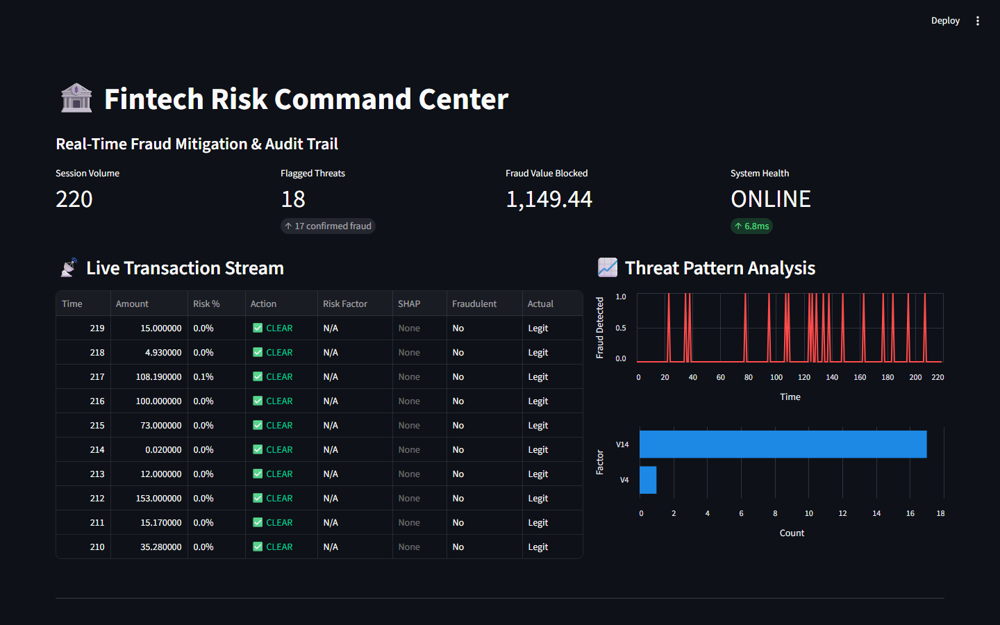
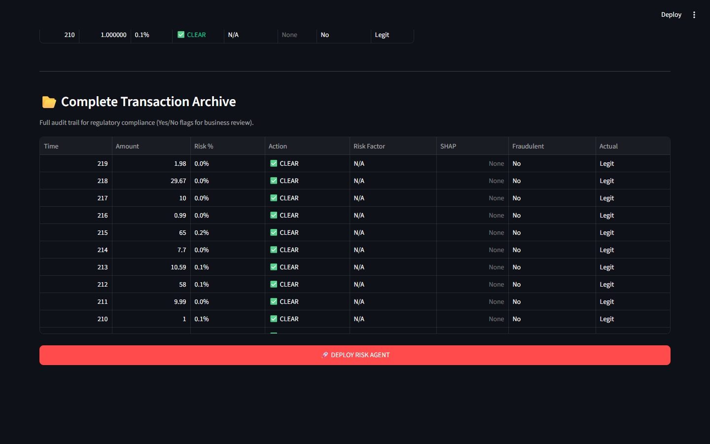

# Card Fraud Detection Engine

An XGBoost fraud classifier on 284,807 European card transactions, with a Streamlit dashboard that replays held-out transactions as a live feed and explains every block with SHAP.

   



## The problem

Only 0.17% of the transactions in this dataset are fraud (492 of 284,807). A model that labels everything "legit" is 99.8% accurate and catches nothing, so accuracy is the wrong yardstick. What matters is how many frauds are caught (recall) and how many good customers are blocked by mistake (precision).

## How it works

1. **Data:** the Kaggle / ULB credit card fraud dataset (September 2013, European cardholders). Features `V1`–`V28` are PCA components released anonymised by the data owner, plus `Amount`. `Time` is dropped.
2. **Model:** 80/20 stratified train/test split, then XGBoost with `scale_pos_weight` = legit-to-fraud ratio (~578), so each missed fraud costs as much in training as ~578 misclassified legit transactions.
3. **Live feed:** clicking **Deploy Risk Agent** draws 20 fraud and 200 legit transactions from the **test set**, shuffles them, and scores them one by one.
4. **Explanation:** for every blocked transaction, a SHAP `TreeExplainer` finds the feature that pushed the score furthest towards fraud. That feature and its SHAP value appear in the table, and the pattern chart counts them. Because `V1`–`V28` are anonymised, the app shows the feature name rather than inventing a business label for it.
5. **Ground truth next to the decision:** each row also shows the actual label, so false alarms are visible. "Fraud Value Blocked" counts only correctly blocked fraud.

In test sessions, 16–17 of the 20 frauds were blocked with 0–1 false alarms, and `V14` was the dominant driver, consistent with common analyses of this dataset.

## Evaluation on the full test set

`python evaluate.py` scores all 56,962 held-out transactions (98 frauds). Full output: [reports/metrics.md](reports/metrics.md).

- **PR-AUC 0.859.** A random model scores 0.0017; for a 0.17% event, this is the metric that matters.

| Threshold | Frauds caught | Recall | Precision | False alarms | Fraud value caught |
|---|---|---|---|---|---|
| 0.5 (app default) | 83 / 98 | 84.7% | 72.8% | 31 | 64.0% |
| 0.9 | 80 / 98 | 81.6% | 89.9% | 9 | 63.1% |
| Rule baseline: block amounts > 1,012 | 1 / 98 | 1.0% | 0.2% | 599 | 17.0% |

**What this shows:**
- Raising the threshold from 0.5 to 0.9 cuts false alarms from 31 to 9 and loses only 3 frauds.
- The model catches 85% of fraud cases but only 64% of fraud **value**, so it misses some of the largest frauds. The next step is cost-sensitive training that weights each fraud by its amount.



## Run it locally

```bash
git clone https://github.com/vighnesh-shetty-vs/Real-Time-Financial-Fraud-Detection-Engine.git
cd Real-Time-Financial-Fraud-Detection-Engine
pip install -r requirements.txt
streamlit run app.py
```

`creditcard.csv` (~144 MB) is stored with Git LFS. If you cloned without LFS, run `git lfs pull` first. The model trains once on startup (about a minute) and is then cached.

## Limits and next steps

- The model trains when the app starts. A production version would train offline, save the model, and report precision, recall and PR-AUC on the full test set.
- The decision threshold is XGBoost's default 0.5. The evaluation above shows 0.9 is a better trade-off; the final choice should come from the cost of a missed fraud vs a blocked customer.
- "Real-time" here means scoring one transaction at a time in the UI (single-digit milliseconds), not a streaming pipeline.

---

Vighnesh Shetty · MSc Data Analytics for Business, KEDGE Business School · [Portfolio](https://vighnesh-shetty-vs.github.io/portfolio-website-vighnesh/)
